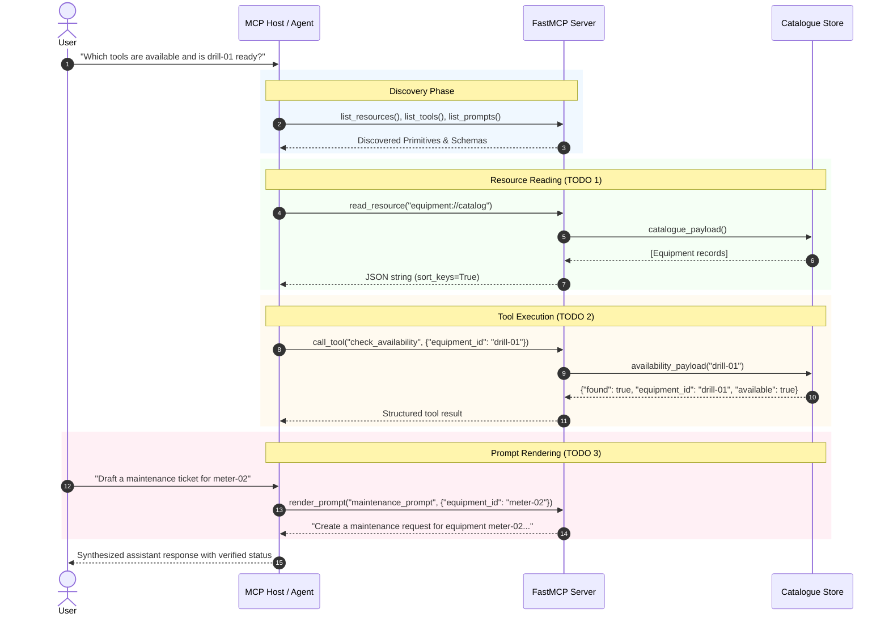

# Expose Three MCP Primitives: Equipment Workshop

[](https://www.python.org/)
[](https://docs.pytest.org/)
[](https://github.com/jlowin/fastmcp)
[](https://modelcontextprotocol.io/)
[](LICENSE)

A local equipment workshop server exposing the three foundational **Model Context Protocol (MCP)** primitives—**Resources**, **Tools**, and **Prompts**—built with the standalone `FastMCP` framework. The server allows MCP-compatible host agents (such as Claude Desktop, Cursor, Groq, or custom LLM orchestrators) to discover, inspect, and invoke local workshop capabilities with strict typing, deterministic serialization, and immutability guarantees.

---

## Table of Contents

- [Overview](#overview)
- [The Three MCP Primitives](#the-three-mcp-primitives)
  - [1. Resource: `equipment_catalog`](#1-resource-equipment_catalog)
  - [2. Tool: `check_availability`](#2-tool-check_availability)
  - [3. Prompt: `maintenance_prompt`](#3-prompt-maintenance_prompt)
- [Architecture & Interaction Lifecycle](#architecture--interaction-lifecycle)
- [Catalogue Data Model](#catalogue-data-model)
- [Implementation Details](#implementation-details)
  - [TODO 1: Equipment Catalog Resource](#todo-1-equipment-catalog-resource)
  - [TODO 2: Availability Check Tool](#todo-2-availability-check-tool)
  - [TODO 3: Maintenance Request Prompt](#todo-3-maintenance-request-prompt)
- [Host Integration & In-Process Invocation](#host-integration--in-process-invocation)
- [Project Structure](#project-structure)
- [Installation & Quickstart](#installation--quickstart)
- [Running the Test Suite](#running-the-test-suite)
- [License](#license)

---

## Overview

The **Model Context Protocol (MCP)** standardizes how applications provide context, actions, and workflows to Large Language Models (LLMs). Rather than hardcoding custom integrations or fragile prompt strings, an MCP server provides a uniform interface consisting of three core primitives:

1. **Resources:** Read-only data payloads exposed via custom URIs that provide passive context to the model.
2. **Tools:** Callable executable functions with JSON schemas allowing models to perform actions and query dynamic state.
3. **Prompts:** Pre-defined, parameterized prompt templates that guide model interactions and workflows.

This repository implements an in-memory equipment workshop MCP server named `"Equipment Workshop"`. It provides hosts with an immutable catalog of workshop tools, a real-time availability checker, and a structured prompt generator for filing equipment maintenance requests.

```
+-------------------------------------------------------------------------+
|                              MCP Host                                   |
|               (LLM Agent / Claude / Cursor / Groq Host)                 |
+-------------------------------------------------------------------------+
       |                               |                              |
       | 1. Read Resource              | 2. Call Tool                 | 3. Render Prompt
       |    equipment://catalog        |    check_availability()      |    maintenance_prompt()
       v                               v                              v
+-------------------------------------------------------------------------+
|                  "Equipment Workshop" FastMCP Server                    |
|                                                                         |
|  [Resource]              [Tool]                  [Prompt]               |
|  equipment_catalog()     check_availability()    maintenance_prompt()   |
|  - JSON Catalogue        - Status Dict           - Templated Markdown   |
|  - Deterministic sort    - Known & Unknown IDs   - Parameterized        |
|  - Immutable Data        - Typed Schema          - Single Turn User     |
+-------------------------------------------------------------------------+
```

---

## The Three MCP Primitives

### 1. Resource: `equipment_catalog`

- **URI:** `equipment://catalog`
- **Discovered Name:** `equipment_catalog`
- **MIME Type:** `text/plain`
- **Purpose:** Exposes the workshop's inventory as a stable, read-only JSON document.
- **Payload:** Serialized list of equipment records containing ID, name, and availability status.
- **Determinism:** Serialized using `json.dumps(..., sort_keys=True)` ensuring canonical representations across repeated host calls.

### 2. Tool: `check_availability`

- **Discovered Name:** `check_availability`
- **Input Argument:** `equipment_id: str` (Required)
- **Input Schema:**
  ```json
  {
    "type": "object",
    "properties": {
      "equipment_id": {
        "type": "string"
      }
    },
    "required": ["equipment_id"],
    "additionalProperties": false
  }
  ```
- **Returns:** Structured JSON dictionary indicating whether the equipment was found, its ID, and its availability status or error code.

### 3. Prompt: `maintenance_prompt`

- **Discovered Name:** `maintenance_prompt`
- **Arguments:** `equipment_id` (Required string)
- **Purpose:** Parameterizes a standardized maintenance request template for LLM consumption.
- **Renders:**
  ```text
  Create a maintenance request for equipment {equipment_id}. Include observed symptoms and proposed inspection steps.
  ```

---

## Architecture & Interaction Lifecycle



---

## Catalogue Data Model

The workshop inventory is defined as an immutable tuple of frozen `Equipment` dataclasses:

```python
@dataclass(frozen=True)
class Equipment:
    equipment_id: str
    name: str
    available: bool

CATALOGUE = (
    Equipment("drill-01", "Cordless Drill", True),
    Equipment("meter-02", "Digital Multimeter", False),
    Equipment("camera-03", "Thermal Camera", True),
)
```

### Static Inventory State

| Equipment ID | Equipment Name | Available | Description |
| :--- | :--- | :---: | :--- |
| `drill-01` | Cordless Drill | `True` | Battery-powered variable speed workshop drill |
| `meter-02` | Digital Multimeter | `False` | Precision multimeter (currently checked out / maintenance) |
| `camera-03` | Thermal Camera | `True` | High-resolution thermal diagnostic camera |

---

## Implementation Details

The implementation in `main.py` provides exact solutions for all three primitive TODOs without altering decorators, signatures, or type annotations:

### TODO 1: Equipment Catalog Resource

```python
@mcp.resource("equipment://catalog")
def equipment_catalog() -> str:
    """Return the complete equipment catalogue as stable JSON."""
    return json.dumps(catalogue_payload(), sort_keys=True)
```
- **URI Mapping:** Registered to URI `equipment://catalog`.
- **Payload Invariance:** Uses `catalogue_payload()` to convert dataclasses to plain dicts.
- **Canonical Serialization:** `sort_keys=True` ensures deterministic key order across all host invocations (`"available"`, `"equipment_id"`, `"name"`).
- **Immutability:** Host reads cannot mutate underlying `CATALOGUE` tuples or dataclasses.

### TODO 2: Availability Check Tool

```python
@mcp.tool
def check_availability(equipment_id: str) -> dict:
    """Expose the supplied availability result through the typed MCP tool."""
    return availability_payload(equipment_id)
```
- **Parameter Validation:** Typed `equipment_id: str` automatically generates JSON schema with `required: ["equipment_id"]`.
- **Known IDs:** Returns `{ "found": True, "equipment_id": "...", "available": bool }`.
- **Unknown IDs:** Returns `{ "found": False, "equipment_id": "...", "error": "equipment_not_found" }`.

### TODO 3: Maintenance Request Prompt

```python
@mcp.prompt
def maintenance_prompt(equipment_id: str) -> str:
    """Format the supplied maintenance prompt with the requested ID."""
    return MAINTENANCE_TEMPLATE.format(equipment_id=equipment_id)
```
- **Parameterization:** Declares `equipment_id` as a required prompt argument.
- **Template Rendering:** Interpolates `{equipment_id}` into `MAINTENANCE_TEMPLATE` while preserving inspection instructions.

---

## Host Integration & In-Process Invocation

FastMCP allows in-process host invocation using `asyncio` without spawning child processes, opening network sockets, or managing sub-processes:

```python
import asyncio
from main import mcp

async def run_host_session():
    # 1. Discover primitives
    tools = await mcp.list_tools()
    resources = await mcp.list_resources()
    prompts = await mcp.list_prompts()
    
    print(f"Discovered {len(tools)} tools, {len(resources)} resources, {len(prompts)} prompts.")
    
    # 2. Read catalogue resource
    catalog = await mcp.read_resource("equipment://catalog")
    print("Catalog:", catalog.contents[0].content)
    
    # 3. Check tool availability
    status = await mcp.call_tool("check_availability", {"equipment_id": "drill-01"})
    print("Drill-01 status:", status.structured_content)
    
    # 4. Render maintenance prompt
    prompt = await mcp.render_prompt("maintenance_prompt", {"equipment_id": "meter-02"})
    print("Prompt text:", prompt.messages[0].content.text)

if __name__ == "__main__":
    asyncio.run(run_host_session())
```

### Groq Host Integration Shell

The project includes an example Groq host adapter (`utils/host_agent.py`) demonstrating how external LLM agents combine user instructions with local MCP tool results:

```python
from utils.host_agent import GroqEquipmentHost

host = GroqEquipmentHost(api_key="gsk-...")
response = host.answer(
    user_text="Can I borrow drill-01?",
    tool_result="{'found': True, 'equipment_id': 'drill-01', 'available': True}"
)
```

---

## Project Structure

```
ExposeThreeMCPPrimitives/
├── main.py                     # FastMCP server with 3 completed primitive functions
├── requirements.txt            # Project dependencies (pytest, groq, fastmcp)
├── pytest.ini                  # Pytest configuration (pythonpath = .)
├── LICENSE                     # MIT License
├── README.md                   # Comprehensive technical documentation
├── tests/
│   └── test_main.py            # 30 unit & integration tests covering all primitives
└── utils/
    ├── __init__.py             # Package marker
    ├── catalog.py              # Equipment dataclass, CATALOGUE tuple, payload helpers
    └── host_agent.py           # Groq LLM integration host wrapper
```

---

## Installation & Quickstart

### 1. Prerequisites

- Python 3.10+ (Tested through Python 3.14)
- Git

### 2. Clone the Repository

```bash
git clone https://github.com/Shubhankart101/ExposeThreeMCPPrimitives.git
cd ExposeThreeMCPPrimitives
```

### 3. Install Dependencies

```bash
pip install -r requirements.txt
```

### 4. Run the FastMCP Server

To run the server over standard input/output (stdio transport) for MCP hosts:

```bash
python main.py
```

---

## Running the Test Suite

The test suite validates:
- Direct function invocation of all three primitives
- Stable JSON serialization and alphabetical key ordering (`sort_keys=True`)
- Immutable catalog guarantees across repeated calls
- FastMCP resource, tool, and prompt discovery schemas
- In-process resource reading (`read_resource`), tool execution (`call_tool`), and prompt rendering (`render_prompt`)
- Handling of known, unknown, empty, and special-character equipment IDs
- Groq integration shell error handling and message structuring

Run the tests using `pytest`:

```bash
pytest -v
```

### Test Output

```
============================= test session starts =============================
platform win32 -- Python 3.14.6, pytest-8.4.1, pluggy-1.6.0
configfile: pytest.ini
collected 30 items

tests/test_main.py::TestEquipmentCatalogResource::test_direct_call_returns_string PASSED [  3%]
tests/test_main.py::TestEquipmentCatalogResource::test_direct_call_parses_as_valid_json PASSED [  6%]
tests/test_main.py::TestEquipmentCatalogResource::test_direct_call_matches_catalogue_payload PASSED [ 10%]
tests/test_main.py::TestEquipmentCatalogResource::test_direct_call_sort_keys_deterministic PASSED [ 13%]
tests/test_main.py::TestEquipmentCatalogResource::test_catalogue_contains_expected_equipment PASSED [ 16%]
tests/test_main.py::TestEquipmentCatalogResource::test_catalogue_immutability_on_repeated_calls PASSED [ 20%]
tests/test_main.py::TestEquipmentCatalogResource::test_fastmcp_resource_discovery PASSED [ 23%]
tests/test_main.py::TestEquipmentCatalogResource::test_fastmcp_read_resource PASSED [ 26%]
tests/test_main.py::TestCheckAvailabilityTool::test_known_available_equipment PASSED [ 30%]
tests/test_main.py::TestCheckAvailabilityTool::test_known_unavailable_equipment PASSED [ 33%]
tests/test_main.py::TestCheckAvailabilityTool::test_known_thermal_camera PASSED [ 36%]
tests/test_main.py::TestCheckAvailabilityTool::test_unknown_equipment_id PASSED [ 40%]
tests/test_main.py::TestCheckAvailabilityTool::test_empty_string_equipment_id PASSED [ 43%]
tests/test_main.py::TestCheckAvailabilityTool::test_nonexistent_formatted_id PASSED [ 46%]
tests/test_main.py::TestCheckAvailabilityTool::test_matches_helper_directly PASSED [ 50%]
tests/test_main.py::TestCheckAvailabilityTool::test_fastmcp_tool_discovery PASSED [ 53%]
tests/test_main.py::TestCheckAvailabilityTool::test_fastmcp_tool_parameters_schema PASSED [ 56%]
tests/test_main.py::TestCheckAvailabilityTool::test_fastmcp_call_tool_known PASSED [ 60%]
tests/test_main.py::TestCheckAvailabilityTool::test_fastmcp_call_tool_unknown PASSED [ 63%]
tests/test_main.py::TestMaintenancePrompt::test_renders_template_with_equipment_id PASSED [ 66%]
tests/test_main.py::TestMaintenancePrompt::test_renders_template_with_unknown_id PASSED [ 70%]
tests/test_main.py::TestMaintenancePrompt::test_renders_template_with_special_characters PASSED [ 73%]
tests/test_main.py::TestMaintenancePrompt::test_fastmcp_prompt_discovery PASSED [ 76%]
tests/test_main.py::TestMaintenancePrompt::test_fastmcp_prompt_arguments_schema PASSED [ 80%]
tests/test_main.py::TestMaintenancePrompt::test_fastmcp_render_prompt PASSED [ 83%]
tests/test_main.py::TestGroqEquipmentHostAndExtras::test_groq_host_missing_api_key_raises PASSED [ 86%]
tests/test_main.py::TestGroqEquipmentHostAndExtras::test_groq_host_answer_formatting PASSED [ 90%]
tests/test_main.py::TestGroqEquipmentHostAndExtras::test_global_catalogue_is_frozen PASSED [ 93%]
tests/test_main.py::TestGroqEquipmentHostAndExtras::test_server_metadata PASSED [ 96%]
tests/test_main.py::TestGroqEquipmentHostAndExtras::test_multiple_sequential_resource_and_tool_calls PASSED [100%]

============================= 30 passed in 1.30s ==============================
```

---

## License

This project is licensed under the MIT License - see the [LICENSE](LICENSE) file for details.
